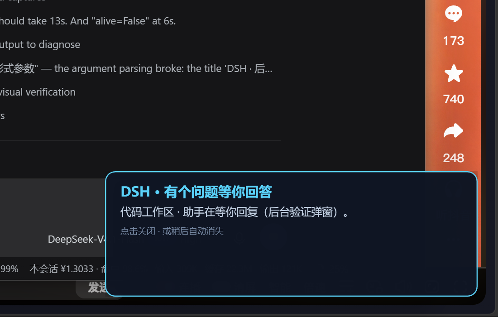

# dsh-ask-alert

> DSH plugin that puts an always-on-top reminder card on your desktop when the assistant asks you a question, waits for approval, or finishes a task — with taskbar flash, a sound, and repeated reminders until you answer.

English | [中文](./README.md)



## Why

In DeepSeek Harness, `ask_user_question` parks the turn until you answer. If you are watching a video in another window, it is easy to miss that the agent is blocked.

The usual approach is a native Windows toast, which regularly fails in practice:

- with the master notification switch off (`ToastEnabled=0`) the toast API still returns success but **nothing is displayed**;
- Focus Assist / Do Not Disturb silently drops banners;
- many notifier plugins run `powershell -File x.ps1`, and Windows PowerShell defaults to the `Restricted` execution policy, so the script is refused and the plugin fails silently with no visible error.

This plugin does not depend on the system notification switch: it draws its own **always-on-top card** in the bottom-right corner, requires no notification permission, and never steals focus.

## Features

- ✅ **Question alert** — fires as soon as the agent calls `ask_user_question`
- ✅ **Approval alert** — fires when an action waits for allow/deny (optional)
- ✅ **Task-done alert** — fires when the current turn ends and the agent goes idle (optional)
- 🔁 **Repeated reminders** — repeats every 20 s, up to 5 times while unanswered
- 🪟 **Always-on-top card** — rounded card, `ShowActivated=false`, auto-dismiss after 13 s, click to close
- 💡 **Taskbar flash** — `FlashWindowEx` + `FLASHW_TIMERNOFG`, keeps flashing until DSH is focused again
- 🔔 **Sound** — system notification sound plus an attention chime
- 🧹 **No stacking** — a new reminder closes the previous card

## Install

```powershell
dsh plugin --profile desktop add github:bgfhsnm/dsh-ask-alert
```

Or through the UI: **Plugins → Add plugin → `github:bgfhsnm/dsh-ask-alert` → Enable**.

Takes effect immediately; no restart needed (the host half only listens to events and registers no service, tool, or settings namespace).

> Windows 10/11 with an interactive desktop session. No npm dependencies and no build step.

## How it works

| Event | Behaviour |
| --- | --- |
| `user-questions/request` | Alert immediately, then repeat while unanswered |
| `approval/request` | Alert while the decision is pending |
| `agent/status` (`idle`, root session only) | Single alert when a turn finishes |

Delivery is handled by `notify.ps1` (launched with `-ExecutionPolicy Bypass`, so it also works on machines left at the default `Restricted` policy): WinRT toast (best effort) → taskbar flash → sound → always-on-top card.

`%TEMP%\dsh-ask-alert.pid` tracks the current card process so only one card is on screen at a time.

## Configuration

The defaults work out of the box. The plugin exports a `Config` schema and renders it from its browser half (`lib/client.js`) as a form in the **Plugins → Ask alerts** page: twelve fields in four groups (texts, timing, style, repeat). There is no save button: switches write on click, text and number fields write when they lose focus (or on Enter), and a small status line reports the result.

To keep configuration in version control or scripts, you can still override the row in your profile's `cordis.patch.yml` (same values as the settings form):

```yaml
- id: dsh-ask-alert
  config:
    askTitle: 'DSH · 有个问题等你回答'
    askBody: '助手在等你回复，请切回 DeepSeek Harness。'
    approveTitle: 'DSH · 需要你确认'
    approveBody: '有一个操作正在等你批准或拒绝。'
    doneTitle: 'DSH · 任务完成'
    doneBody: '这一轮任务已结束，可以回来查看结果了。'
    repeatSeconds: 20      # repeat interval, 0 = notify once
    maxAlerts: 5           # maximum alerts including the first one
    onApproval: true       # approval alerts
    onDone: true           # task-done alerts
    showProject: true      # prefix the body with the session folder name
```

Restart DSH after editing. To keep only question alerts:

```yaml
- id: dsh-ask-alert
  config:
    onDone: false
```

## Testing

```powershell
node selftest.mjs   # drives the event logic through a mock ctx (10 assertions)
```

Exercise the delivery path end to end (a real card will appear):

```powershell
powershell -NoProfile -ExecutionPolicy Bypass -File notify.ps1 `
  -Kind ask -Title 'DSH · test' -Body 'If you can see this card, delivery works' -Sound 1
```

## Known limitations

- Windows only, and it needs an interactive desktop session.
- The taskbar flash looks for a window whose title contains `DeepSeek`; if the DSH window title is changed, the card still shows but the taskbar will not flash.
- The card is anchored to the bottom-right of the primary work area; multi-monitor and custom-scaling placement is not tuned.
- Chinese text in `.ps1` files must be saved as UTF-8 with BOM, otherwise Windows PowerShell 5.1 decodes it as GBK and reports bogus syntax errors (the shipped file already has a BOM).

## License

MIT
