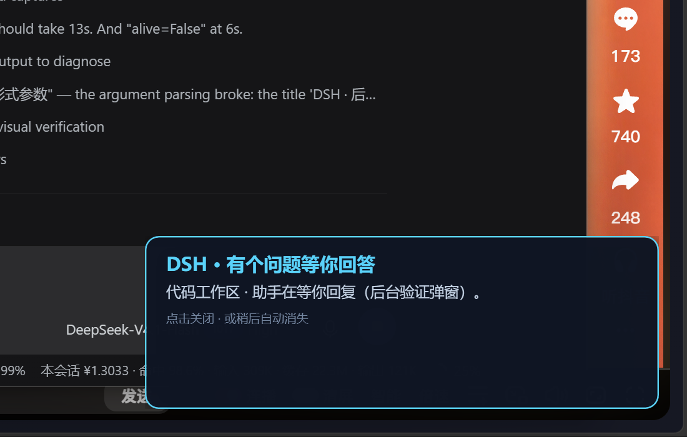

# dsh-ask-alert · 提问提醒

> DSH 插件：助手向你提问、等待审批或一轮任务结束时，在桌面弹出置顶提醒卡片，并闪任务栏、响提示音；问题没回答会按间隔重复提醒。

[English](./README.en.md) | 中文



## 为什么需要它

在 DeepSeek Harness 里，助手提问（`ask_user_question`）后会一直等你回答。如果你正在别的窗口看视频、看直播或者做饭，很容易整轮对话卡在那里。

常见的做法是弹 Windows 原生通知，但实际经常失效：

- 系统「通知」总开关被关掉时（`ToastEnabled=0`），toast 调用**返回成功但什么都不显示**；
- 「专注助手 / 免打扰」会把横幅静默掉；
- 不少通知类插件用 `powershell -File x.ps1` 拉起脚本，而 Windows PowerShell 默认执行策略是 Restricted，脚本直接被拒绝，插件静默失败，界面上没有任何报错。

本插件不依赖系统通知开关：它自己画一张**置顶卡片**放在屏幕右下角，不需要通知权限，也不会抢走当前窗口的焦点。

## 功能

- ✅ **提问提醒**：助手调用 `ask_user_question` 时立即提醒
- ✅ **审批提醒**：有操作等待批准/拒绝时提醒（可关）
- ✅ **任务完成提醒**：一轮任务结束、助手转为空闲时提醒（可关）
- 🔁 **重复提醒**：提问/审批未回答时，每 20 秒再提醒一次，默认最多 5 次（可调）
- 🪟 **置顶卡片**：右下角圆角卡片，`ShowActivated=false` 不抢焦点，13 秒自动消失，点一下即可关闭
- 💡 **任务栏闪烁**：`FlashWindowEx` + `FLASHW_TIMERNOFG`，DSH 在后台时会一直闪到你切回去
- 🔔 **提示音**：系统通知音 + 独占音效，防止专注助手静音
- 🧹 **不堆叠**：新提醒会自动关掉上一条卡片

## 安装

```powershell
dsh plugin --profile desktop add github:bgfhsnm/dsh-ask-alert
```

也可以走图形界面：**插件 → 添加插件 → 填 `github:bgfhsnm/dsh-ask-alert` → 立即启用**。

安装后无需重启即可生效（Host 半身只监听事件，不注册 service / tool / settings）。

> 需要 Windows 10/11 与桌面会话。插件本身不依赖 npm 依赖，无需构建。

## 工作方式

| 事件 | 触发内容 |
| --- | --- |
| `user-questions/request` | 助手提问 → 立即提醒，并在未回答期间重复 |
| `approval/request` | 等待批准/拒绝 → 提醒，并在未决期间重复 |
| `agent/status`（`idle`，仅根会话） | 一轮任务结束 → 单次提醒 |

提醒由 `notify.ps1` 执行（`-ExecutionPolicy Bypass`，兼容默认 Restricted 的机器）：WinRT toast（尽力）→ 任务栏闪烁 → 提示音 → 置顶卡片。

`%TEMP%\dsh-ask-alert.pid` 记录当前卡片进程，保证同一时间只有一张卡片。

## 配置

默认值即可直接使用。需要定制时，在 profile 的 `cordis.patch.yml` 里覆盖对应行：

```yaml
- id: dsh-ask-alert
  config:
    askTitle: 'DSH · 有个问题等你回答'
    askBody: '助手在等你回复，请切回 DeepSeek Harness。'
    approveTitle: 'DSH · 需要你确认'
    approveBody: '有一个操作正在等你批准或拒绝。'
    doneTitle: 'DSH · 任务完成'
    doneBody: '这一轮任务已结束，可以回来查看结果了。'
    repeatSeconds: 20      # 重复提醒间隔，0 = 只提醒一次
    maxAlerts: 5           # 最多提醒次数（含第一次）
    onApproval: true       # 审批提醒开关
    onDone: true           # 任务完成提醒开关
    showProject: true      # 在正文前加会话目录名
```

修改后重启 DSH 生效。

只想保留提问提醒、不要「任务完成」打扰：

```yaml
- id: dsh-ask-alert
  config:
    onDone: false
```

## 自测

```powershell
node selftest.mjs   # 用 mock ctx 跑事件逻辑，10 项断言
```

直接验证提醒链路（会真的弹一张卡片）：

```powershell
powershell -NoProfile -ExecutionPolicy Bypass -File notify.ps1 `
  -Kind ask -Title 'DSH · 测试' -Body '看到这张卡片说明链路正常' -Sound 1
```

## 已知限制

- 仅 Windows；依赖桌面会话（服务/无头会话里没有可显示的窗口）。
- 任务栏闪烁需要能找到标题包含 `DeepSeek` 的窗口；DSH 窗口标题被改掉时只会弹卡片、不闪任务栏。
- 卡片固定出现在主屏工作区右下角，双屏/自定义缩放下的位置未做单独适配。
- 中文 `.ps1` 必须以 UTF-8 with BOM 保存，否则 Windows PowerShell 5.1 会按 GBK 解码并报假语法错误（仓库内文件已带 BOM）。

## License

MIT
